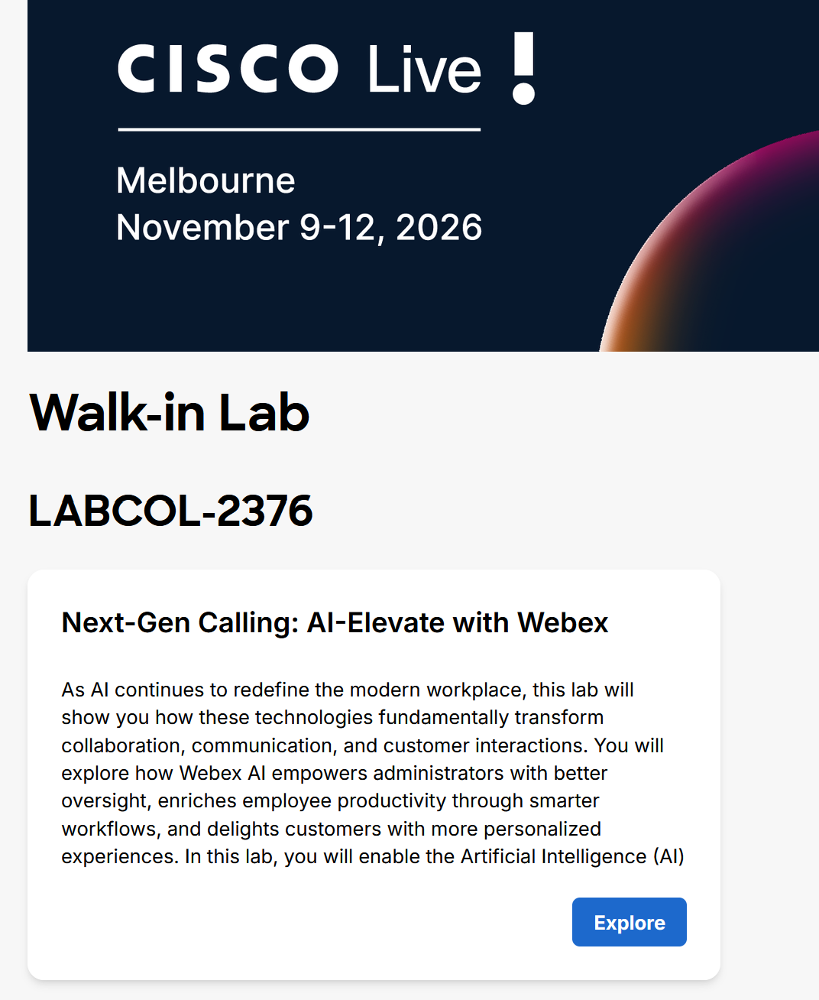
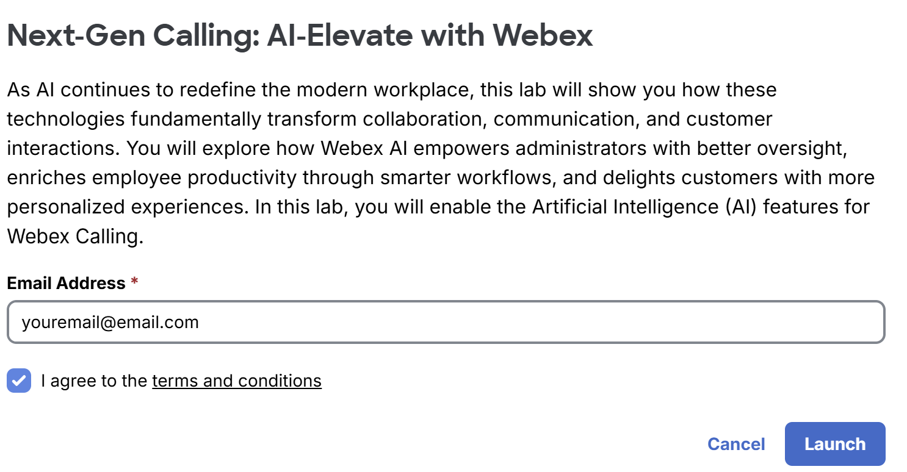
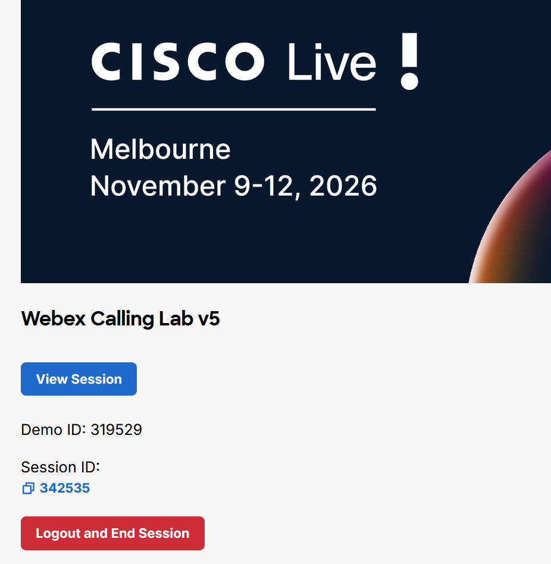
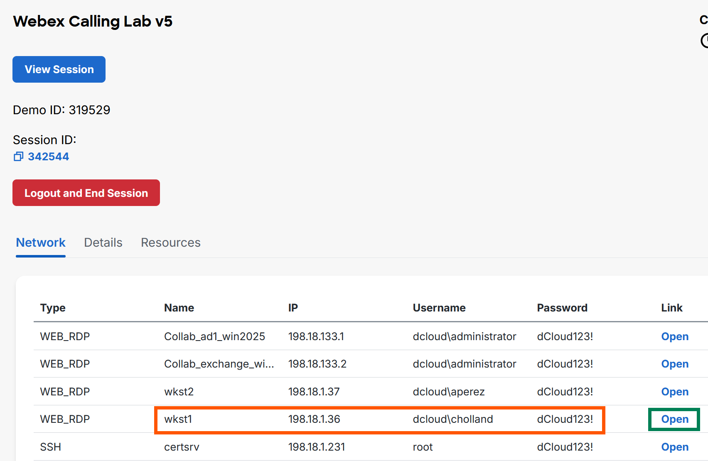
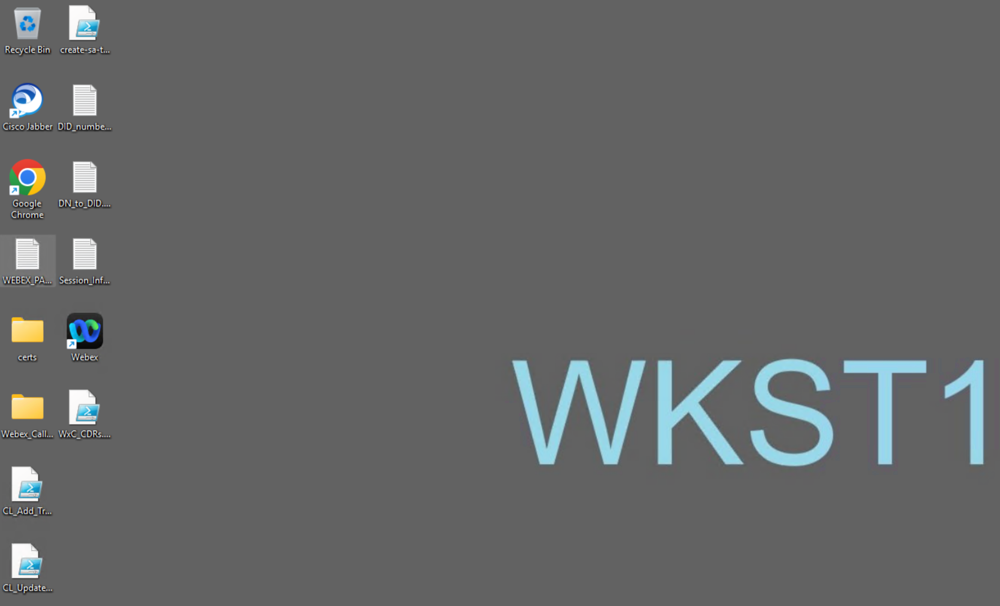
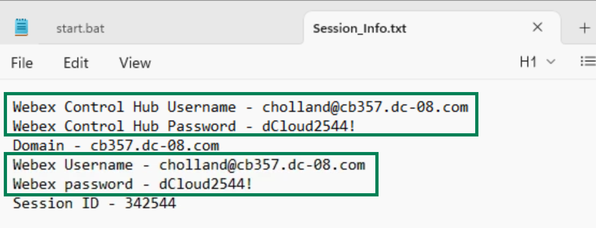

> **Lab data notice:** Values in screenshots are examples from the source guide. Use the credentials, addresses, phone numbers, and session details assigned to your own pod.

# Accessing your Lab

All components for this lab can be accessed through a web browser.

Open a browser on your physical workstation and go to https://www.ciscodcloud.com/apps/expo/2tln8e04up4hxtmgevewp765y

Click Explore for LABCOL-2376.

<figure class="lab-figure">
  
  <figcaption>Source guide screenshot 4. Use the values assigned to your own lab pod.</figcaption>
</figure>

Enter your email and click Launch.

<figure class="lab-figure">
  
  <figcaption>Source guide screenshot 5. Use the values assigned to your own lab pod.</figcaption>
</figure>

You will be automatically assigned to a lab pod, and you will be taken to the Lab homepage as shown below.

<figure class="lab-figure">
  
  <figcaption>Source guide screenshot 6. Use the values assigned to your own lab pod.</figcaption>
</figure>

## Connect to Workstation 1 via Remote Desktop

Connect to the Remote desktop of Workstation 1. On your session topology click workstation 1 and click Remote Desktop to connect

<figure class="lab-figure">
  
  <figcaption>Source guide screenshot 7. Use the values assigned to your own lab pod.</figcaption>
</figure>

<figure class="lab-figure">
  
  <figcaption>Source guide screenshot 8. Use the values assigned to your own lab pod.</figcaption>
</figure>

Within Workstation 1’s Desktop, there will be a file named Session_info.txt as shown above. Launch the file to get the username and password for the Webex App and the Collaboration Control Hub for this lab.

<figure class="lab-figure">
  
  <figcaption>Source guide screenshot 9. Use the values assigned to your own lab pod.</figcaption>
</figure>

## Login to Collaboration Control Hub from within Workstation 1

Lauch the Chrome browser from within workstation 1and go to https://admin.webex.com. Login using the credentials from the Session_info.txt file from the previous section. If you do not see the Session_info.txt file, follow the instructions below. Otherwise, begin Module 1 of this lab. All the lab tasks should be completed from within Workstation 1

Now you can proceed with the lab modules.
