> **Lab data notice:** Values in screenshots are examples from the source guide. Use the credentials, addresses, phone numbers, and session details assigned to your own pod.

# Module 1: Setting up a Webex Calling org in the Control Hub

## Module 1a: Setup Cisco Calling Plan for a location

In this module we will import random/fake phone (DID) numbers to the Control Hub, define the Main number for the location in Control Hub, and assign a number to the user Charles Holland. In a customer environment, when you have an existing PSTN provider and DID numbers, you can import all your DID numbers into Control Hub and assign them as the Main number and/or to any user for Webex Calling.

1. Within Workstation 1, open the Chrome browser from the taskbar.
2. Go to the Webex Control Hub (https://admin.webex.com). Your pod’s Webex organization’s credentials are placed on the Desktop of Workstation 1 in a file called Session_Indo.txt. You will use the same credentials to login to the Control Hub and the Webex App for the user Charles Holland in this lab. Refer to the screenshots below.
<figure class="lab-figure">
  <a class="screenshot-link" href="assets/source-guide/image10.png">
    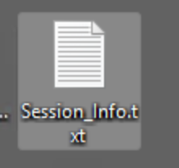
  </a>
  <figcaption>Source guide screenshot 10. Use the values assigned to your own lab pod.</figcaption>
</figure>

<figure class="lab-figure">
  <a class="screenshot-link" href="assets/source-guide/image11.png">
    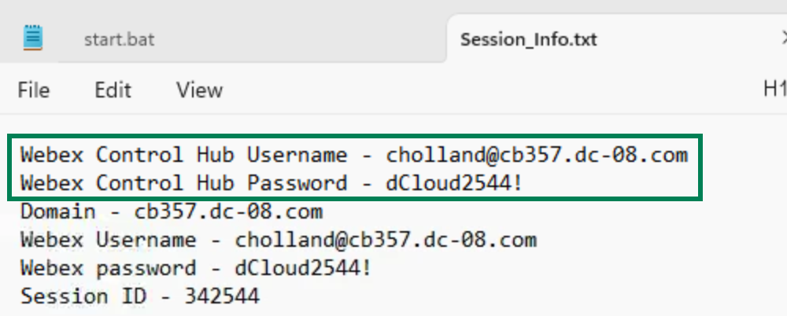
  </a>
  <figcaption>Source guide screenshot 11. Use the values assigned to your own lab pod.</figcaption>
</figure>

3. Log in to the Webex Control Hub with your respective pod’s credentials from the file and not using the screenshot credentials shown above.
4. For security reasons, Webex Control Hub signs out every 20 minutes (Idle timeout) by default. For this lab, let’s make the idle time out longer so the Control Hub does not sign you out often during this lab. Go to MANAGEMENT > Organization Settings > Control Hub’s idle timeout. Drop down the option for Control Hub idle timeout and select 12 hours or no timeout. Click Save.
<figure class="lab-figure">
  
  <figcaption>Source guide screenshot 12. Use the values assigned to your own lab pod.</figcaption>
</figure>

5. Go to MANAGEMENT > Location. Click the location called “dCloud-US”. This location is in the US.
<figure class="lab-figure">
  <a class="screenshot-link" href="assets/source-guide/image13.png">
    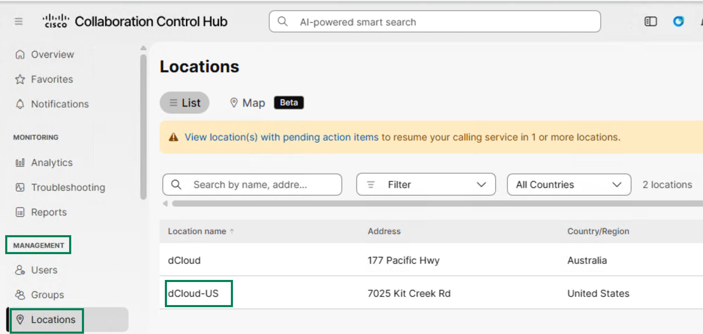
  </a>
  <figcaption>Source guide screenshot 13. Use the values assigned to your own lab pod.</figcaption>
</figure>

6. Click on the PSTN tab as shown below
<figure class="lab-figure">
  <a class="screenshot-link" href="assets/source-guide/image14.png">
    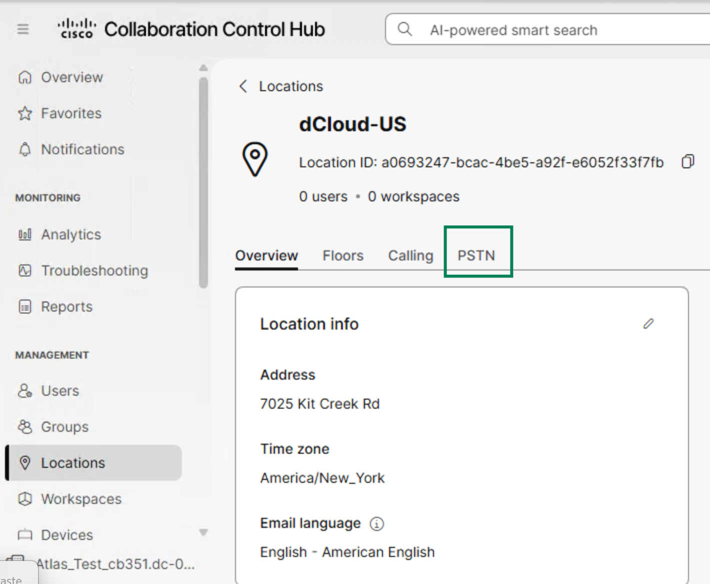
  </a>
  <figcaption>Source guide screenshot 14. Use the values assigned to your own lab pod.</figcaption>
</figure>

7. Click on Manage to edit the PSTN options for the location called dCloud-US as shown below
<figure class="lab-figure">
  <a class="screenshot-link" href="assets/source-guide/image15.png">
    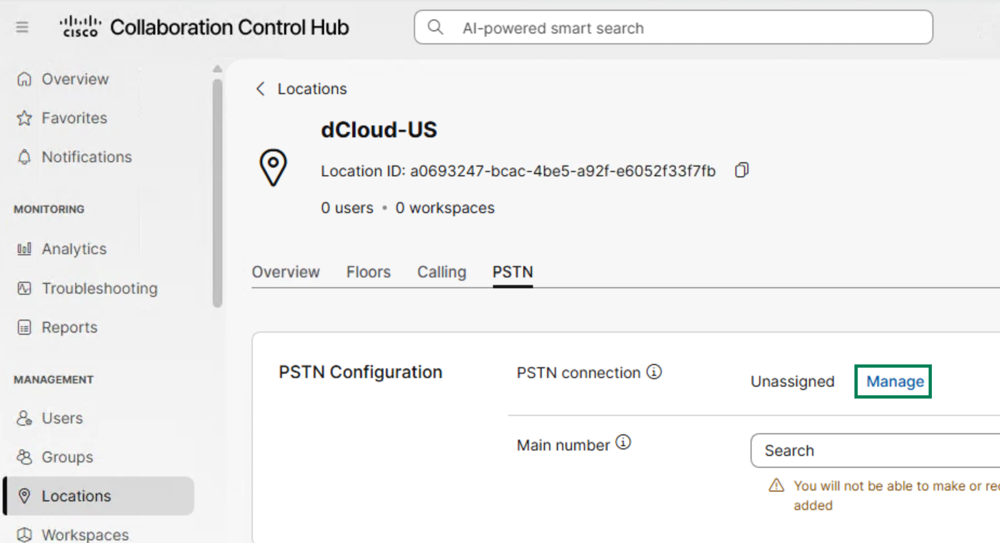
  </a>
  <figcaption>Source guide screenshot 15. Use the values assigned to your own lab pod.</figcaption>
</figure>

8. Select Cisco Calling Plans and click Next
<figure class="lab-figure">
  <a class="screenshot-link" href="assets/source-guide/image16.png">
    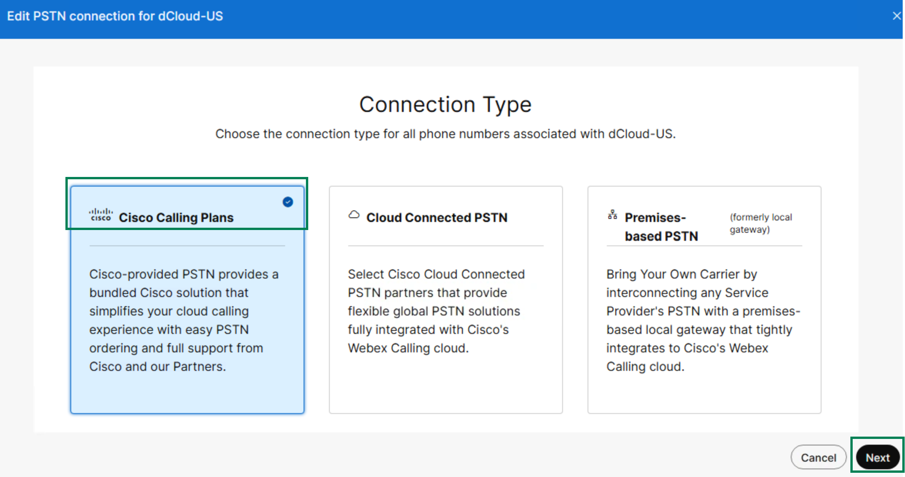
  </a>
  <figcaption>Source guide screenshot 16. Use the values assigned to your own lab pod.</figcaption>
</figure>

9. On the following page populate the information below and click Next. Use the email address as listed in the Session_Info.txt file that you used to login to the Collaboration Control Hub.
10. First Name: Charles
11. Last Name: Holland
12. Email Address: cholland@<your pod’s FQDN>
13. Confirm Email Address: cholland@<your pod’s FQDN>
<figure class="lab-figure">
  <a class="screenshot-link" href="assets/source-guide/image17.png">
    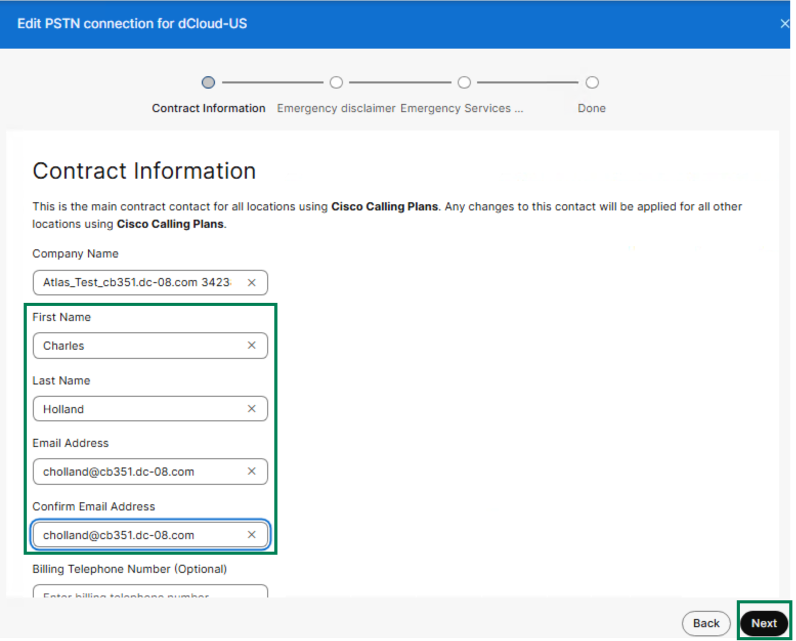
  </a>
  <figcaption>Source guide screenshot 17. Use the values assigned to your own lab pod.</figcaption>
</figure>

14. Click Yes, Change on the Contract Information Update pop-up window.
15. Scroll to the bottom of the Emergency Services Disclaimer and enter Charles Holland / Engineer in the name and job title box. Click agree and continue.
<figure class="lab-figure">
  <a class="screenshot-link" href="assets/source-guide/image18.png">
    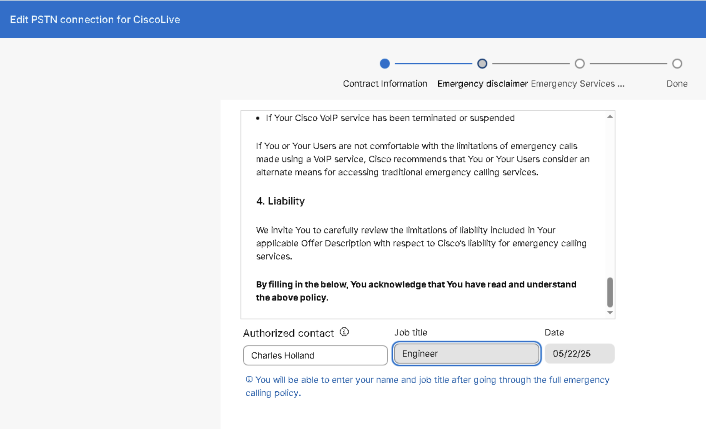
  </a>
  <figcaption>Source guide screenshot 18. Use the values assigned to your own lab pod.</figcaption>
</figure>

16. On the Emergency Services Address, leave all fields default and click Save.
17. Click Done (add numbers later)
<figure class="lab-figure">
  <a class="screenshot-link" href="assets/source-guide/image19.png">
    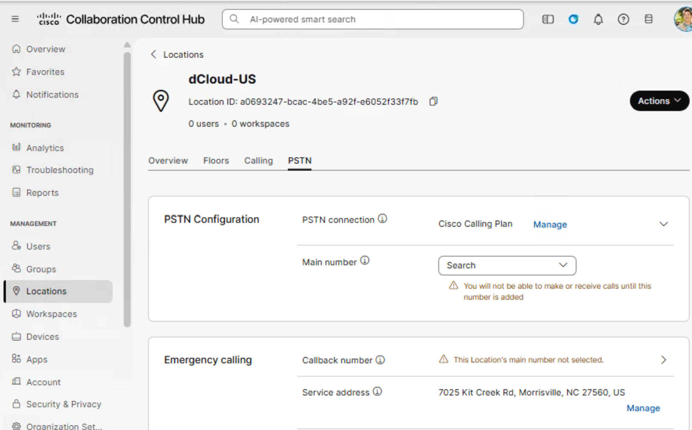
  </a>
  <figcaption>Source guide screenshot 19. Use the values assigned to your own lab pod.</figcaption>
</figure>

18. Now, let’s order new PSTN numbers for this dCloud-US location.
19. Continuing on Workstation 1, on the Collaboration Control Hub, go to SERVICES > PSTN & Routing. Click on +Add Numbers.
<figure class="lab-figure">
  <a class="screenshot-link" href="assets/source-guide/image20.png">
    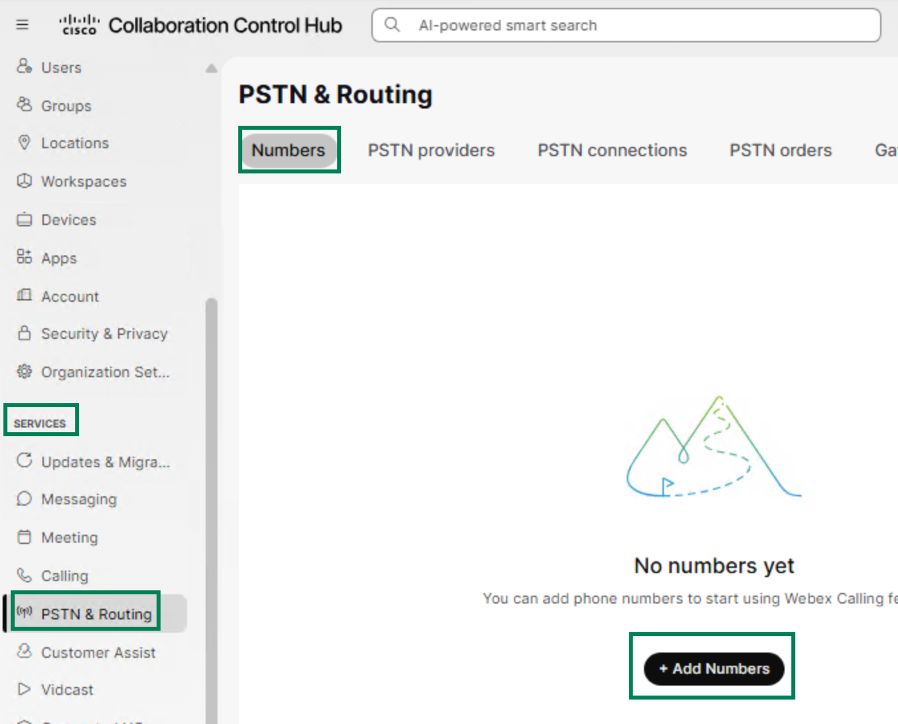
  </a>
  <figcaption>Source guide screenshot 20. Use the values assigned to your own lab pod.</figcaption>
</figure>

20. On the Add Numbers page, drop down the option for Location and choose dCloud-US.
<figure class="lab-figure">
  <a class="screenshot-link" href="assets/source-guide/image21.png">
    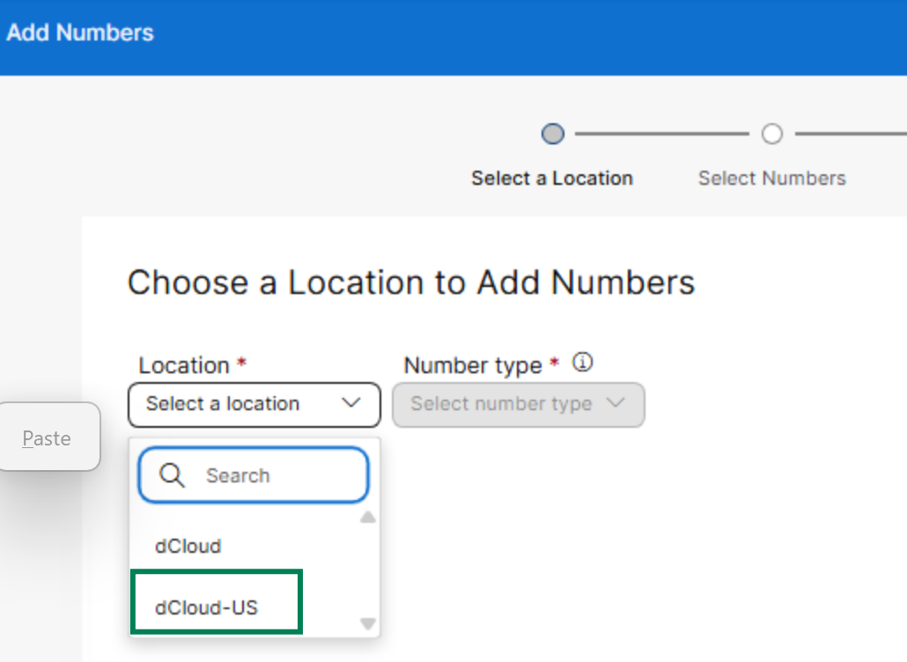
  </a>
  <figcaption>Source guide screenshot 21. Use the values assigned to your own lab pod.</figcaption>
</figure>

21. Keep Order New Numbers option selected and click Next.
<figure class="lab-figure">
  <a class="screenshot-link" href="assets/source-guide/image22.png">
    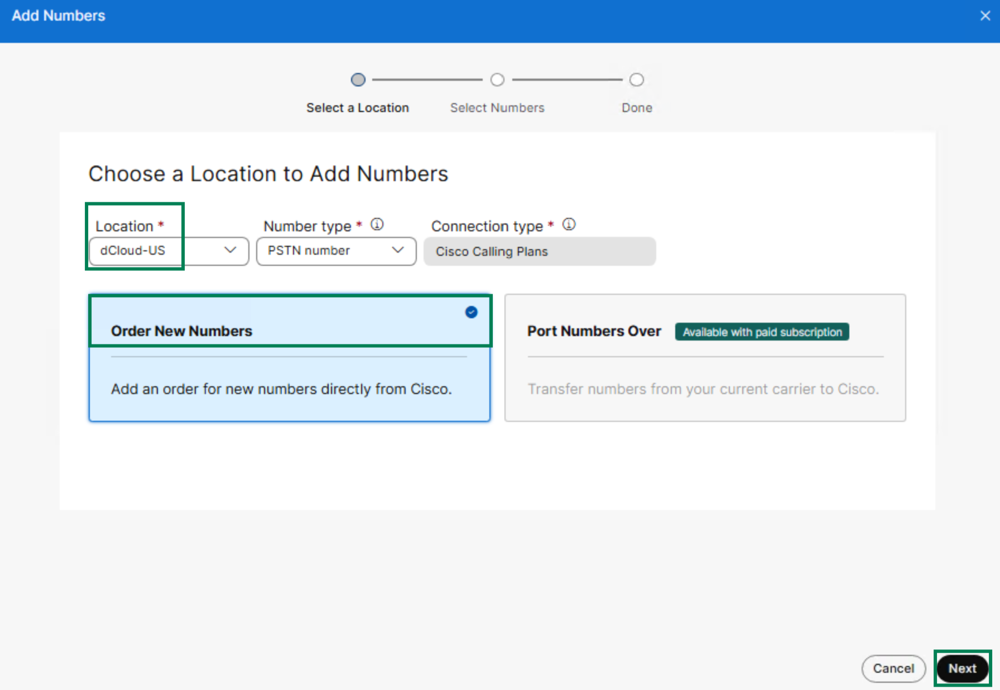
  </a>
  <figcaption>Source guide screenshot 22. Use the values assigned to your own lab pod.</figcaption>
</figure>

22. On the following page keep the default option of Regular phone numbers selected, drop down the option for Area Code and select any area code you like and update the How many numbers do you want to auto-select for you? To 2 and click Search.
<figure class="lab-figure">
  <a class="screenshot-link" href="assets/source-guide/image23.png">
    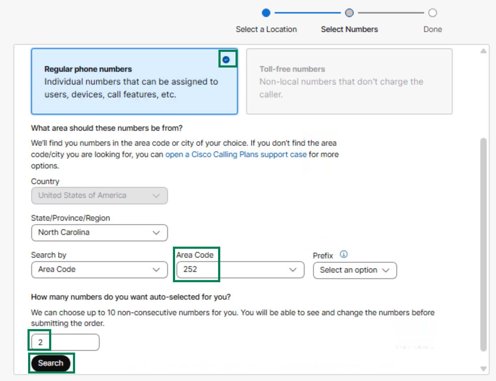
  </a>
  <figcaption>Source guide screenshot 23. Use the values assigned to your own lab pod.</figcaption>
</figure>

23. It will select two numbers from available numbers in the area code you selected. Click Order.
<figure class="lab-figure">
  <a class="screenshot-link" href="assets/source-guide/image24.png">
    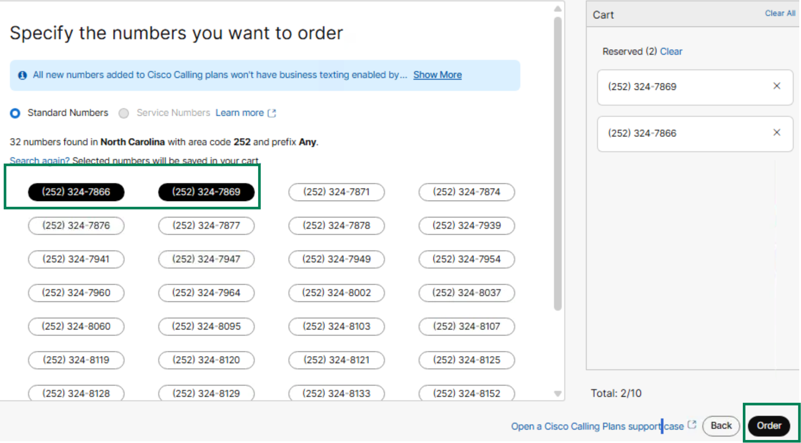
  </a>
  <figcaption>Source guide screenshot 24. Use the values assigned to your own lab pod.</figcaption>
</figure>

24. It will place an order for a new number. Click View orders. It will take you the Orders page. Click on the Order that is in pending state. It will bring up a Flyout window on right, verify the status changed to Provisioned. Now this number is ready to be assigned to a user in Control Hub.
<figure class="lab-figure">
  <a class="screenshot-link" href="assets/source-guide/image25.png">
    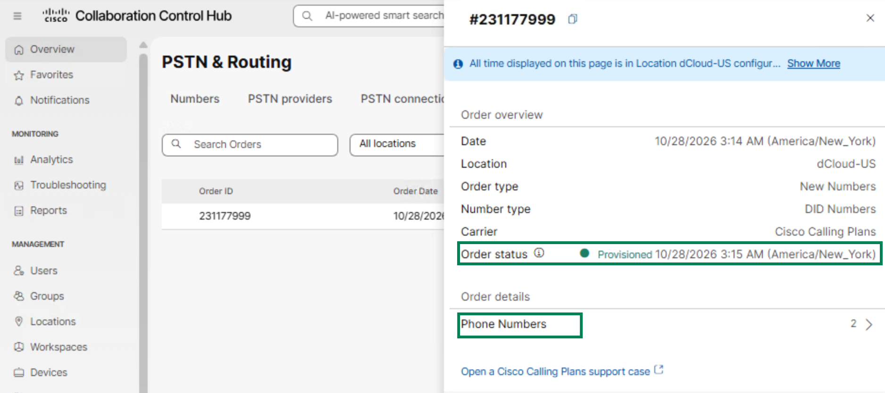
  </a>
  <figcaption>Source guide screenshot 25. Use the values assigned to your own lab pod.</figcaption>
</figure>

<figure class="lab-figure">
  <a class="screenshot-link" href="assets/source-guide/image26.png">
    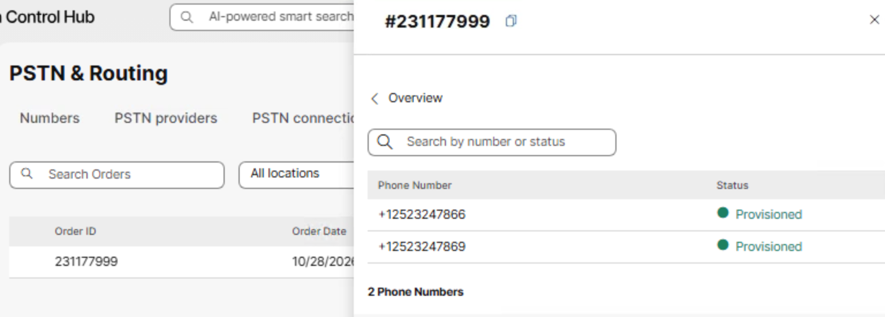
  </a>
  <figcaption>Source guide screenshot 26. Use the values assigned to your own lab pod.</figcaption>
</figure>

25. Now, let’s assign one of these numbers to the dCloud-US Location as the main number. On the Control Hub, go to MANAGEMENT > Locations.
<figure class="lab-figure">
  
  <figcaption>Source guide screenshot 13. Use the values assigned to your own lab pod.</figcaption>
</figure>

26. Select the dCloud-US location. Go to the PSTN tab, you will notice that under the Main Number field, there is a warning that reads You will not be able to make or receive calls until this number is added.
<figure class="lab-figure">
  <a class="screenshot-link" href="assets/source-guide/image27.png">
    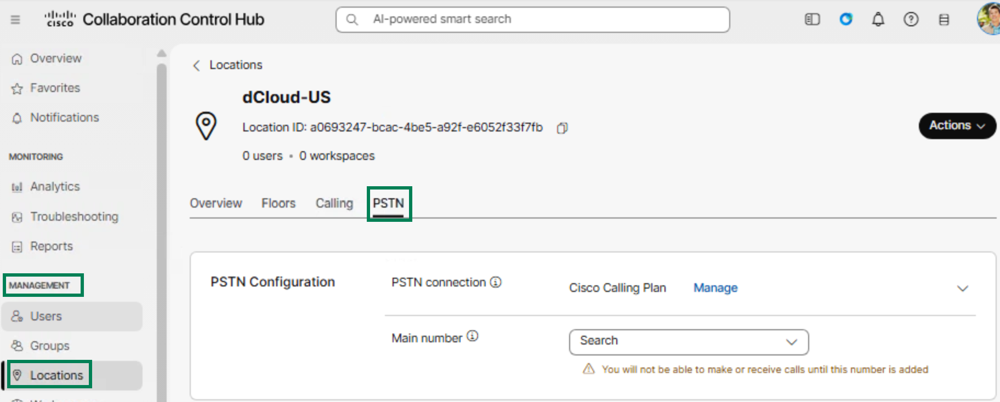
  </a>
  <figcaption>Source guide screenshot 27. Use the values assigned to your own lab pod.</figcaption>
</figure>

27. Drop down the option for Main Number and choose any of the two numbers you have just ordered and click Save.
<figure class="lab-figure">
  <a class="screenshot-link" href="assets/source-guide/image28.png">
    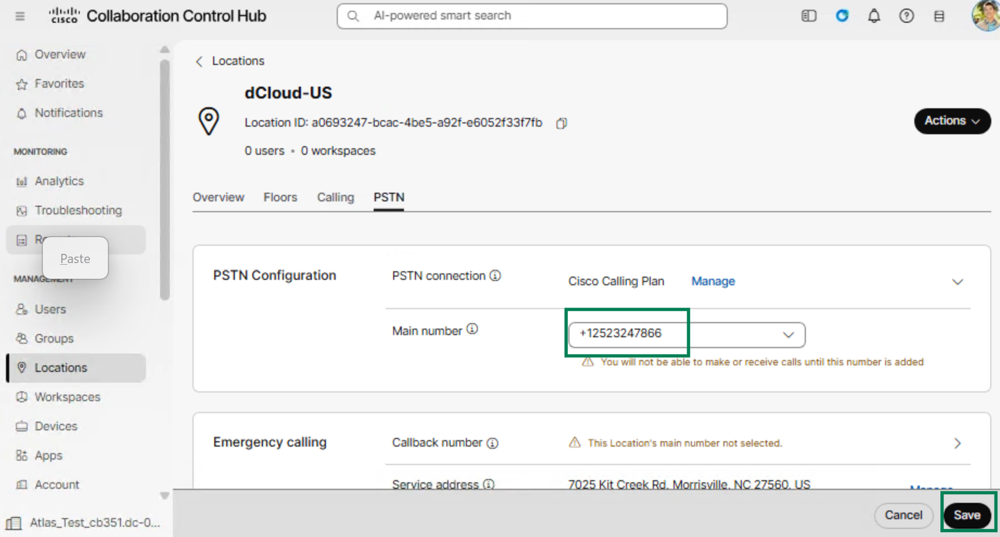
  </a>
  <figcaption>Source guide screenshot 28. Use the values assigned to your own lab pod.</figcaption>
</figure>

28. As soon as you save, the warning will disappear, indicating now your location can make and receive calls.
<figure class="lab-figure">
  <a class="screenshot-link" href="assets/source-guide/image29.png">
    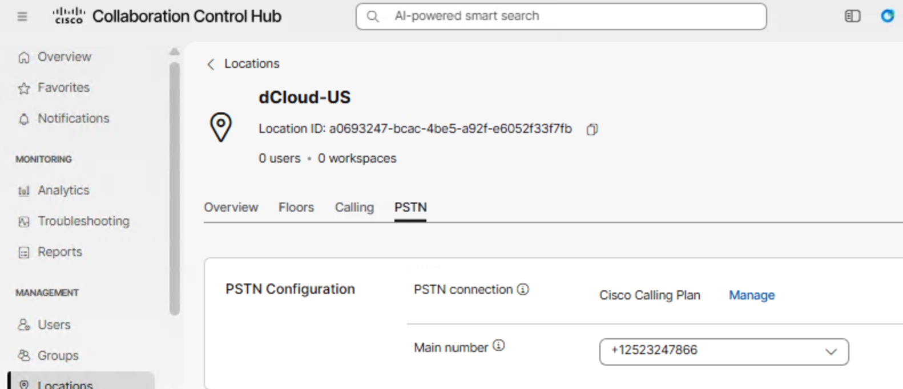
  </a>
  <figcaption>Source guide screenshot 29. Use the values assigned to your own lab pod.</figcaption>
</figure>

## Module 1b: Assigning Calling Licenses to a user on Webex Control Hub

1. Continuing on Workstation 1, Go back to the browser where you have logged in to Webex Control Hub before.
2. Go to MANAGEMENT > Users.
3. Select Charles Holland user from the list of users.
4. On the user Summary page scroll down and click Edit Licenses
<figure class="lab-figure">
  <a class="screenshot-link" href="assets/source-guide/image30.png">
    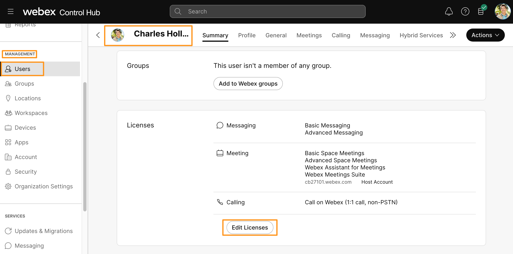
  </a>
  <figcaption>Source guide screenshot 30. Use the values assigned to your own lab pod.</figcaption>
</figure>

5. On the next page click Edit Licenses (towards the bottom right) again.
6. On the next page go to the Calling tab and check mark for both options Webex Calling and Professional and Click Save.
<figure class="lab-figure">
  <a class="screenshot-link" href="assets/source-guide/image31.png">
    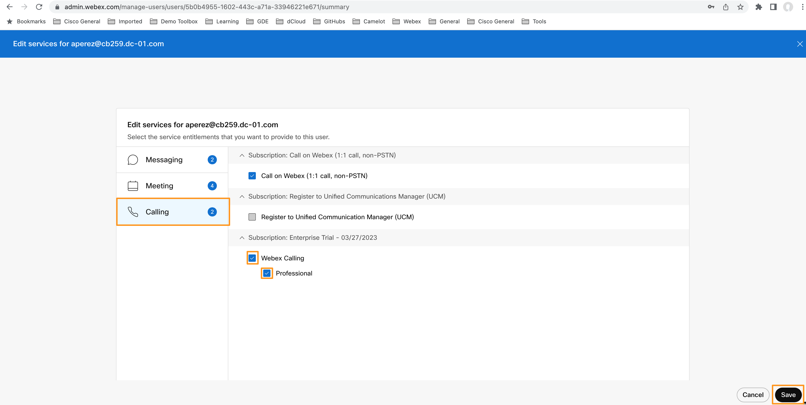
  </a>
  <figcaption>Source guide screenshot 31. Use the values assigned to your own lab pod.</figcaption>
</figure>

7. On the next page, in the dropdown option for Location, select dCloud-US. Drop down Phone Number field and select one of the PSTN Numbers available. Select any number other than the number you have assigned as the Main Number (previous module). Populate the extension field with 6018 for the user. Click Save. Click Close.
<figure class="lab-figure">
  <a class="screenshot-link" href="assets/source-guide/image32.png">
    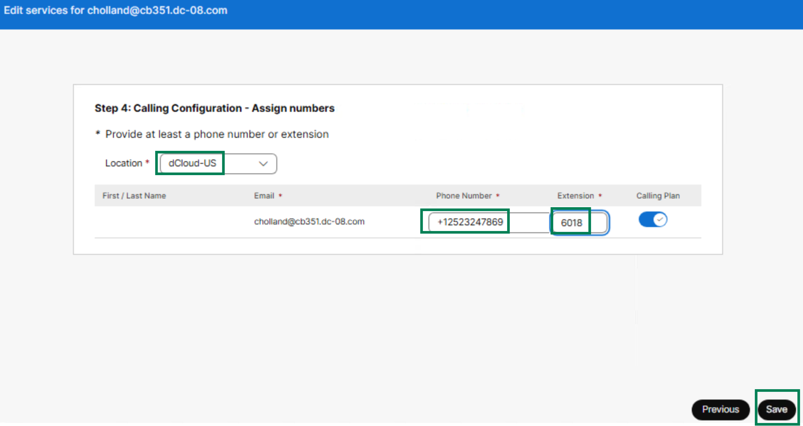
  </a>
  <figcaption>Source guide screenshot 32. Use the values assigned to your own lab pod.</figcaption>
</figure>

8. You will be taken back to the user Summary page. Notice that under Licenses, now Webex Calling Professional has been added for the Calling service.
<figure class="lab-figure">
  <a class="screenshot-link" href="assets/source-guide/image33.png">
    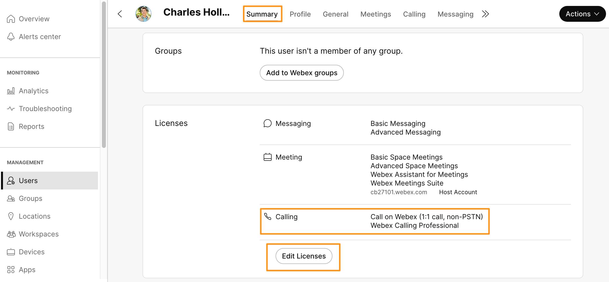
  </a>
  <figcaption>Source guide screenshot 33. Use the values assigned to your own lab pod.</figcaption>
</figure>

9. This completes the Assigning Calling Licenses on the Webex Control Hub Module.
## Module 1c: Enable AI Assistant for Webex Calling

Before users can experience the capabilities of AI-driven collaboration, administrators must first lay the groundwork. This task focuses on activating and configuring the Cisco AI Assistant and its associated features within Collaboration Control Hub.

1. Go to ‘Management > Organization Settings > Cisco AI Assistant & AI features’. Click on Customize AI Assistant & AI features as shown below.
2. Ensure ALL the toggles are turned ON for the Calling AI features. Click ‘Save’
<figure class="lab-figure">
  <a class="screenshot-link" href="assets/source-guide/image34.png">
    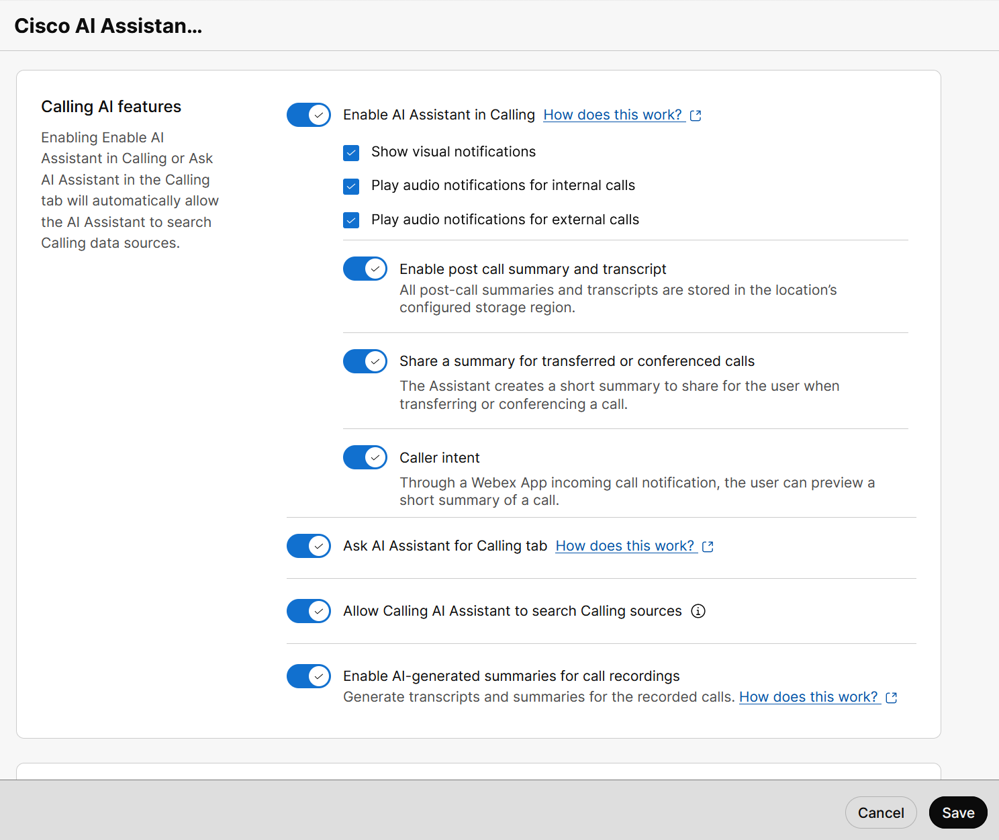
  </a>
  <figcaption>Source guide screenshot 34. Use the values assigned to your own lab pod.</figcaption>
</figure>
