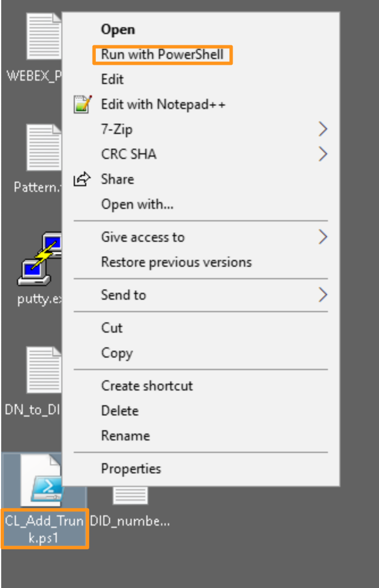
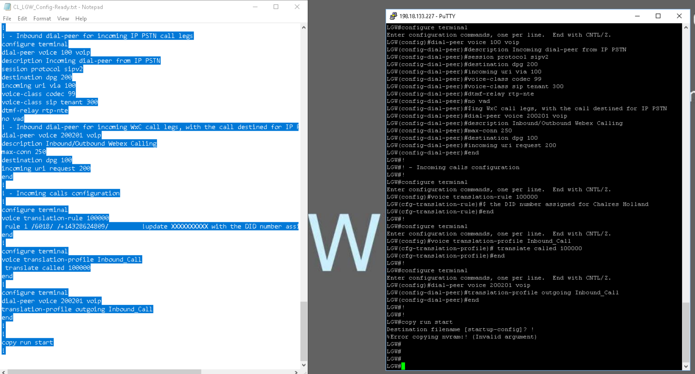
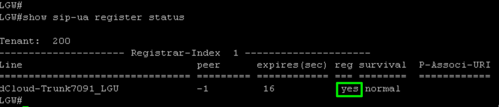
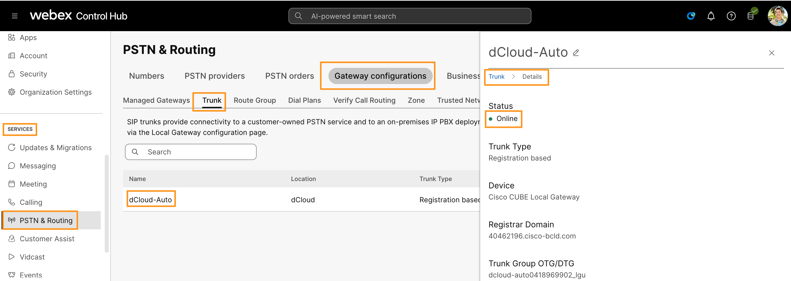
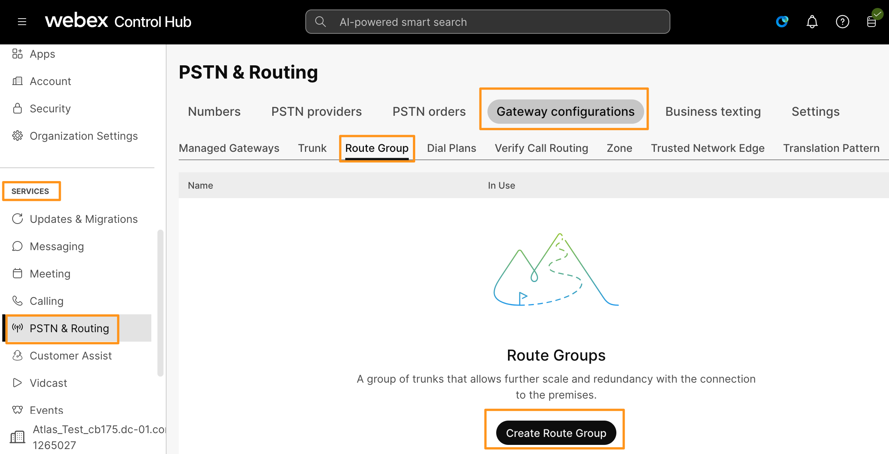
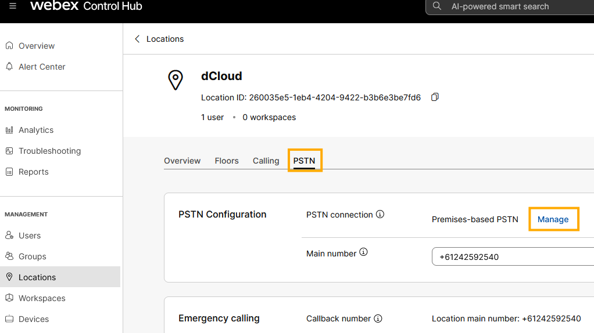
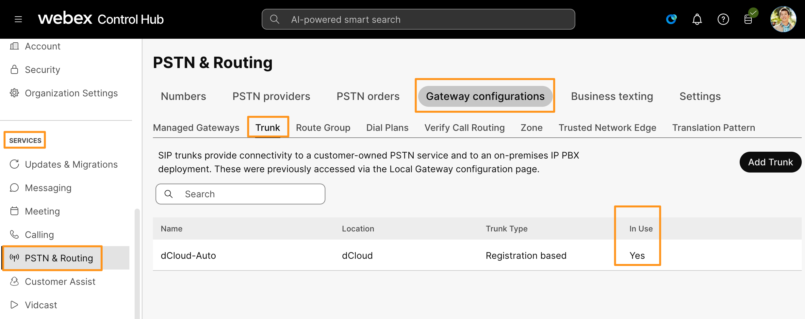

> **Lab data notice:** Values in screenshots are examples from the source guide. Use the credentials, addresses, phone numbers, and session details assigned to your own pod.

# Module 2: Configuring a Local Gateway for Webex Calling

After you configure Webex Calling for your organization, you can configure a trunk to connect your Local Gateway (LGW) to Webex Calling. SIP TLS transport secures the trunk between the Local Gateway and the Webex cloud. The media between the Local Gateway and Webex Calling uses SRTP. You can also import your pre-owned DIDs into Control Hub.

There are two options to configure the Local Gateway for your Webex Calling trunk:

Registration-based trunk

Certificate-based trunk

In this lab, we will cover only Registration-based Trunk.

<figure class="lab-figure">
  
  <figcaption>Source guide screenshot 28. Use the values assigned to your own lab pod.</figcaption>
</figure>

## Module 2a: Local Gateway Configuration

In this module there are sub modules that are CLI (Command Line Interface) based. These sub modules contain downloading the required Root certificate bundle for the Local Gateway (LGW), configuring voice class tenant, voice class SIP profiles, dial-peers and other required commands on the CLI. Due to time limitations, we have created a PowerShell script that adds the premises-based trunk in the Control Hub and generates the CUBE configuration for the Local Gateway. When the script is run, it will generate the entire required configuration for LGW and put it on Workstation 1 Desktop in a file called CL_LGW_ Config-Ready.txt. Once the configuration is generated, you can just copy and paste it in the putty session of the LGW and proceed to next steps.

### Generate the Local Gateway configuration

1. Continuing on **Workstation 1**, minimize all applications and find the PowerShell script named `CL_Add_Trunk.ps1` on the desktop.
2. Right-click the file and select **Run with PowerShell**.

<figure class="lab-figure">
  
  <figcaption>Run the trunk-creation script from the Workstation 1 desktop.</figcaption>
</figure>

3. Wait while the script executes. The PowerShell window closes automatically when it finishes.
4. Confirm that `CL_LGW_Config-Ready.txt` appears on the desktop, then double-click it to open the generated CUBE configuration.

### Confirm that the trunk was added

The PowerShell script performs the **Add Trunk** operation in Control Hub and generates the matching CUBE configuration. Do not create a second trunk manually.

1. In Control Hub, go to **Services > PSTN & Routing > Gateway Configurations > Trunk**.
2. Confirm that the new registration-based trunk, normally named `dCloud-Auto`, appears.
3. The trunk can remain **Offline** until you paste the generated configuration into the LGW and registration completes.
4. If the trunk or `CL_LGW_Config-Ready.txt` is missing, stop and check the PowerShell output before continuing.

<figure class="lab-figure">
  
  <figcaption>Run the supplied script; it creates the Control Hub trunk and generates the matching LGW configuration.</figcaption>
</figure>

<figure class="lab-figure">
  
  <figcaption>Wait for the automated trunk creation and configuration generation to finish.</figcaption>
</figure>

<figure class="lab-figure">
  
  <figcaption>Open the generated configuration file before connecting to the LGW.</figcaption>
</figure>

### Connect to the LGW with PuTTY

1. Open **PuTTY** from the Workstation 1 taskbar or desktop.
2. In **Host Name (or IP address)**, enter `198.18.133.226`.
3. Leave **Port** set to `22`, select **SSH**, and click **Open**.
4. If PuTTY displays a host-key warning, confirm it only after checking that the address matches your assigned lab pod.
5. At the login prompts, enter username `admin` and password `dCloud123!`.

    PuTTY does not display password characters while you type. Press **Enter** after the password and wait for the `LGW#` prompt.

!!! warning "Source screenshot address mismatch"
    The written source step specifies `198.18.133.226`, but the supplied configuration screenshot shows `198.18.133.227` in its PuTTY title bar. Use the address assigned to your lab pod. Do not infer the correct address from the screenshot.

### Paste and apply the generated configuration

1. In `CL_LGW_Config-Ready.txt`, press **Ctrl+A**, then **Ctrl+C** to copy the entire configuration.
2. Return to the authenticated PuTTY window and right-click once inside the terminal to paste. The commands begin running immediately.
3. Wait until the `LGW#` prompt returns. Scroll through the terminal output and check for command errors.
4. You may ignore only the final save error shown after `copy run start`; do not ignore errors from the configuration commands.

<figure class="lab-figure">
  
  <figcaption>Copy the complete generated configuration and paste it into the authenticated LGW session. This supplied screenshot shows a sample pod address; use your assigned address.</figcaption>
</figure>

### Verify Webex Calling registration

1. Wait **2 to 3 minutes** for the LGW to initiate registration with Webex Calling.
2. At the `LGW#` prompt, run `show sip-ua register status`.
3. In the command output, confirm that the **reg** column reports `yes`. If it does not, recheck the pasted Voice Class Tenant and SIP profile configuration before continuing.

<figure class="lab-figure">
  
  <figcaption>The LGW is registered when the <strong>reg</strong> column shows <code>yes</code>.</figcaption>
</figure>

Once the registration status is `yes`, continue to Module 2b.

## Module 2b: Verifying trunk status on Control Hub and assigning it to a route group/location:

Before we start to test the Local Gateway configuration, verify that the premises-based PSTN trunk shows online in Control Hub. Go back to the browser tab where you had Webex Control Hub Open.

Navigate to Services > PSTN & Routing > Gateway Configuration > Trunk. Select the trunk that was added in the above module. On the fly-out window under Details click Trunk Info/Manage.

<figure class="lab-figure">
  
  <figcaption>Source guide screenshot 32. Use the values assigned to your own lab pod.</figcaption>
</figure>

Ensure the status in Control Hub shows Online as displayed above. If the status does not show online, it means that there is some configuration issue. You will need to verify your Voice Class Tenant and SIP profiles on the vCUBE platform.

Once you have verified that the trunk status is online, you can assign this trunk directly to a location or create a Route Group with that trunk and assign the Route Group to a location. Creating a Route Group with a trunk and assigning it to a location helps to have multiple trunks in a route group and in production environments, it avoids service disruptions.

Let's create a Route Group, Go to SERVICES > PSTN & Routing > Gateway Configuration > Route Group tab. Select Create Route Group.

<figure class="lab-figure">
  
  <figcaption>Source guide screenshot 33. Use the values assigned to your own lab pod.</figcaption>
</figure>

It will bring up a new pop-up window to create a new Route Group. On the pop-up window populate the following and click Save.

Name: dCloud-RG

Trunks: Drop down the option and choose the only available trunk (dCloud-Auto)

<figure class="lab-figure">
  
  <figcaption>Source guide screenshot 34. Use the values assigned to your own lab pod.</figcaption>
</figure>

It will create the new Route Group dCloud-RG with the trunk.

1. Now we can assign this Route Group to the location. Click Locations (hyperlink) on the pop-up window. Select the dCloud location under available locations. On the dCloud location page, go to the PSTN tab. On the PSTN tab click Manage (next to PSTN Configuration > PSTN connection).
<figure class="lab-figure">
  
  <figcaption>Source guide screenshot 35. Use the values assigned to your own lab pod.</figcaption>
</figure>

<figure class="lab-figure">
  
  <figcaption>Source guide screenshot 36. Use the values assigned to your own lab pod.</figcaption>
</figure>

On the following page drop down the option for Routing Choice and choose the Route Group you defined. In this lab guide, it's named: dCloud-RG. Checkmark the option to confirm that you understand the impact of these changes. Also notice that as soon as you select the route group from the list, it displays the trunks in that Route Group. Click Next. Click Done (add numbers later) on the following page.

<figure class="lab-figure">
  
  <figcaption>Source guide screenshot 37. Use the values assigned to your own lab pod.</figcaption>
</figure>

Now just to make sure the trunk is assigned to the location, go to SERVICES > PSTN & Routing > Gateway Configuration > Trunk

Under the Trunk tab for the dCloud-Auto (or your trunk name) In Use column should show Yes as shown below. Similarly, if you go to Route Group tab, it will show the dCloud-RG route group In Use.

<figure class="lab-figure">
  
  <figcaption>Source guide screenshot 38. Use the values assigned to your own lab pod.</figcaption>
</figure>

<figure class="lab-figure">
  
  <figcaption>Source guide screenshot 39. Use the values assigned to your own lab pod.</figcaption>
</figure>

This completes verifying the trunk status on Control Hub and assigning it to Route Group/Location.

Note: Test calls to and from PSTN will be done in the next sections, Modules 3 and 4.
