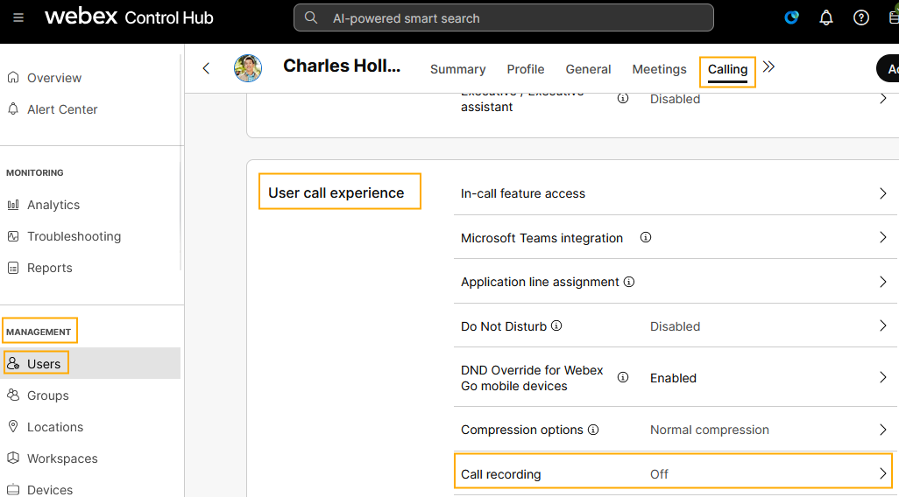
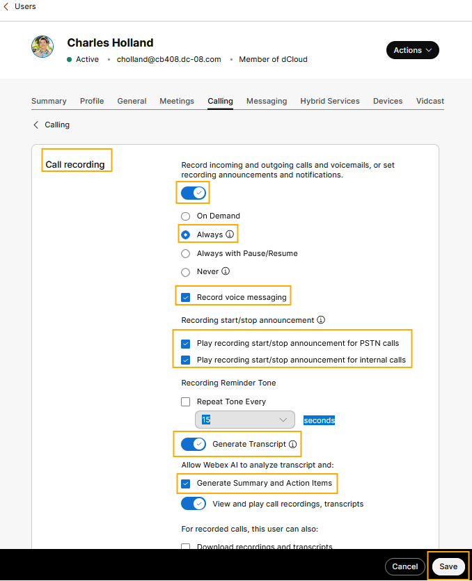
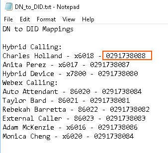
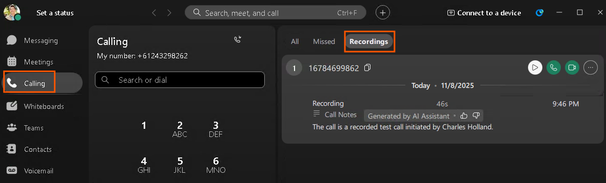
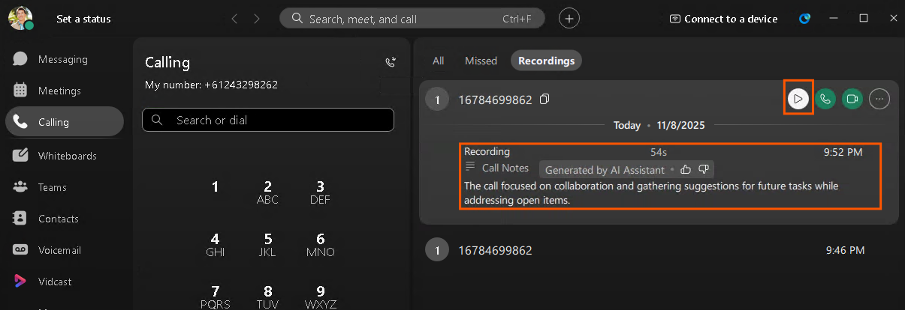
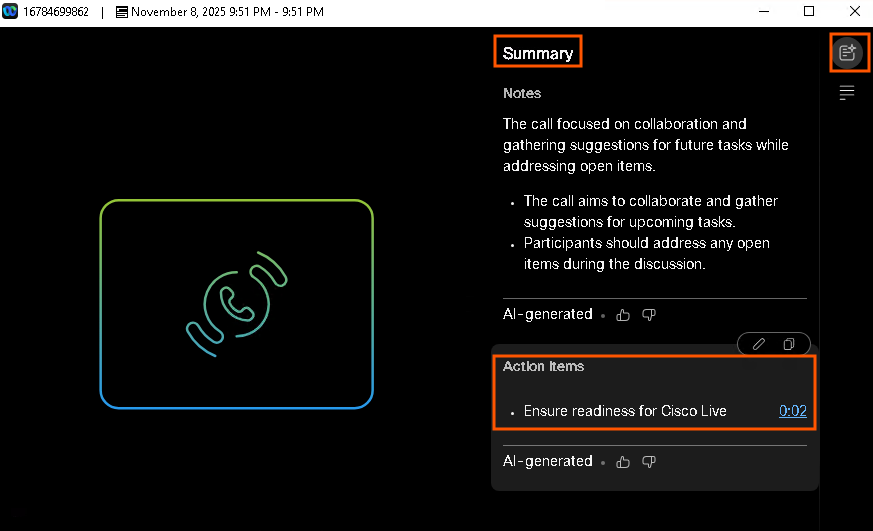
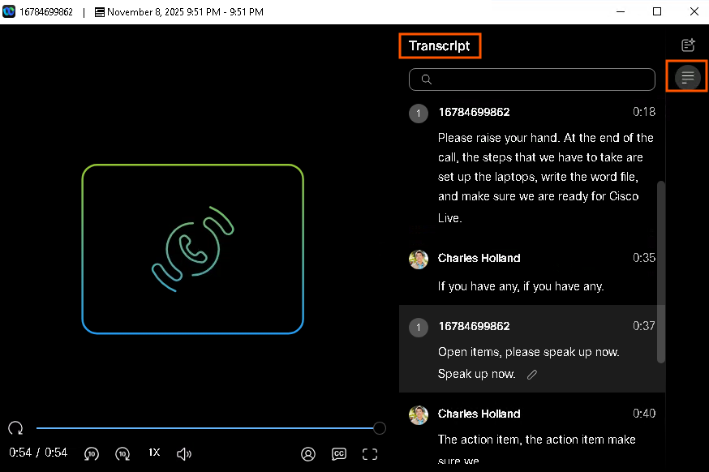

> **Lab data notice:** Values in screenshots are examples from the source guide. Use the credentials, addresses, phone numbers, and session details assigned to your own pod.

# Module 4: AI-generate a transcript for calls recorded by Webex call provider

You can configure automatic transcription for recorded calls. Users can see the transcript in the player when they play the recording from Webex App or User Hub. Transcripts are currently available only for calls recorded by the Webex call recording provider and when the call is in English.

As part of this module, we will test inbound PSTN calls as well.

First, we will enable call recording at the user level, for the user Charles Holland in our organization.

1. Go to Management > Users > select Charles Holland. Then go to Calling > User Call Experience > Call recording.
<figure class="lab-figure">
  
  <figcaption>Source guide screenshot 50. Use the values assigned to your own lab pod.</figcaption>
</figure>

2. Turn on call recording with the settings shown below.
3. Turn on Generate Transcript.
<figure class="lab-figure">
  
  <figcaption>Source guide screenshot 51. Use the values assigned to your own lab pod.</figcaption>
</figure>

## Module 4a: Test Inbound PSTN Calls to Webex Calling via LGW

1. Continuing on Workstation 1, minimize all the applications on the Desktop and open the file named DN_to_DID.txt.
2. Dial the number for the user Charles Holland’s Webex App as shown below.
3. Note: This number will be unique for your pod. Do not dial the number displayed in the screenshot here.
4. Note: If your cell phone is from outside of Australia, then replace the ‘0’ with “+61”. For example, from a US cell phone number, instead of dialing “02 9173 8088”, dial “+61 2 9173 8088”
<figure class="lab-figure">
  
  <figcaption>Source guide screenshot 52. Use the values assigned to your own lab pod.</figcaption>
</figure>

5. Answer the call from the Webex App and keep it up for 20 seconds, talking all this while. You will hear the call recording announcement as the call is being recorded.
6. Hang up the call and proceed to the next section.
## Module 4b: Access AI-generated summaries for call recordings from the Webex App.

Want to catch up on the discussion that happened in a call? When enabled by your organization’s administrator, AI can generate a summary when you play back a call recording. The summary lists the action items and provides the full transcript from the call. So, you can quickly catch up on the discussion and get a better understanding of the conversation at a glance.

1. From the Webex App, click Calling, and then go to Recordings.
<figure class="lab-figure">
  
  <figcaption>Source guide screenshot 53. Use the values assigned to your own lab pod.</figcaption>
</figure>

<figure class="lab-figure">
  
  <figcaption>Source guide screenshot 54. Use the values assigned to your own lab pod.</figcaption>
</figure>

2. Hover over a recording and click to open the recording player, and see the full AI-generated summary, with notes, and action items.
<figure class="lab-figure">
  
  <figcaption>Source guide screenshot 55. Use the values assigned to your own lab pod.</figcaption>
</figure>

<figure class="lab-figure">
  
  <figcaption>Source guide screenshot 56. Use the values assigned to your own lab pod.</figcaption>
</figure>

3. Action items contain a timestamp, to help you easily navigate to the part of the recording in which you're interested.
- In the recording player, select from:
—AI summary, notes, and action items.

<figure class="lab-figure">
  
  <figcaption>Source guide screenshot 57. Use the values assigned to your own lab pod.</figcaption>
</figure>

<figure class="lab-figure">
  
  <figcaption>Source guide screenshot 58. Use the values assigned to your own lab pod.</figcaption>
</figure>

- —view the call transcript.
<figure class="lab-figure">
  
  <figcaption>Source guide screenshot 59. Use the values assigned to your own lab pod.</figcaption>
</figure>

This completes the lab activity.
