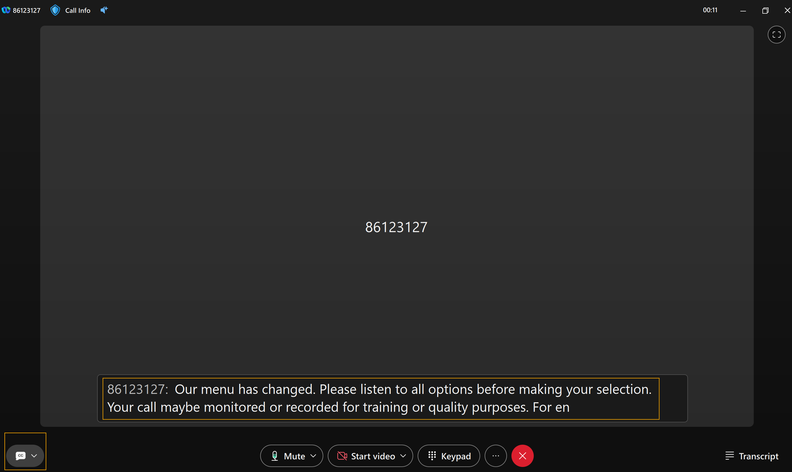
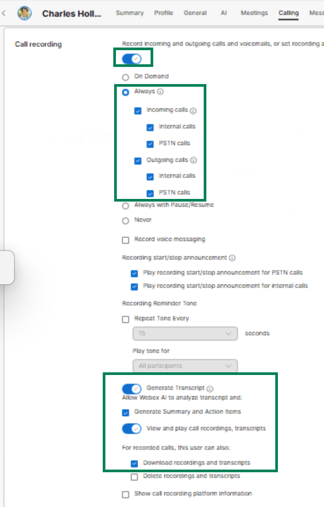
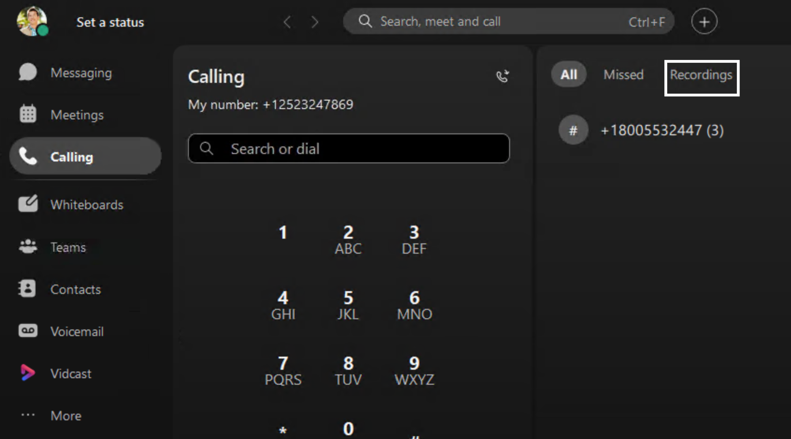
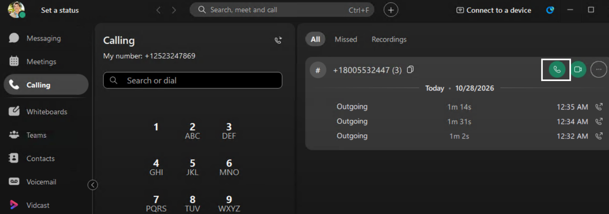
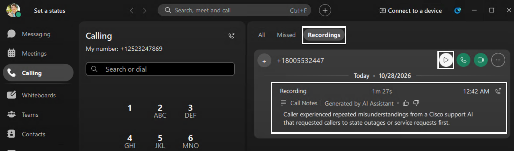
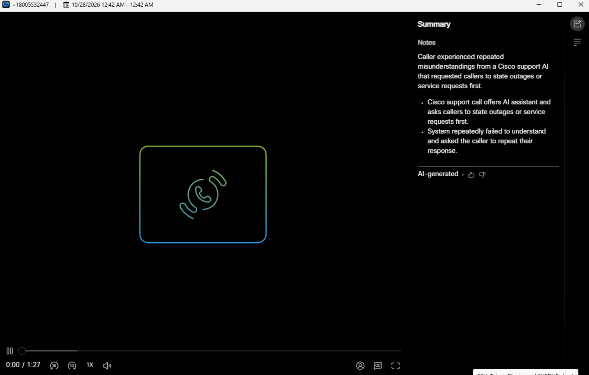
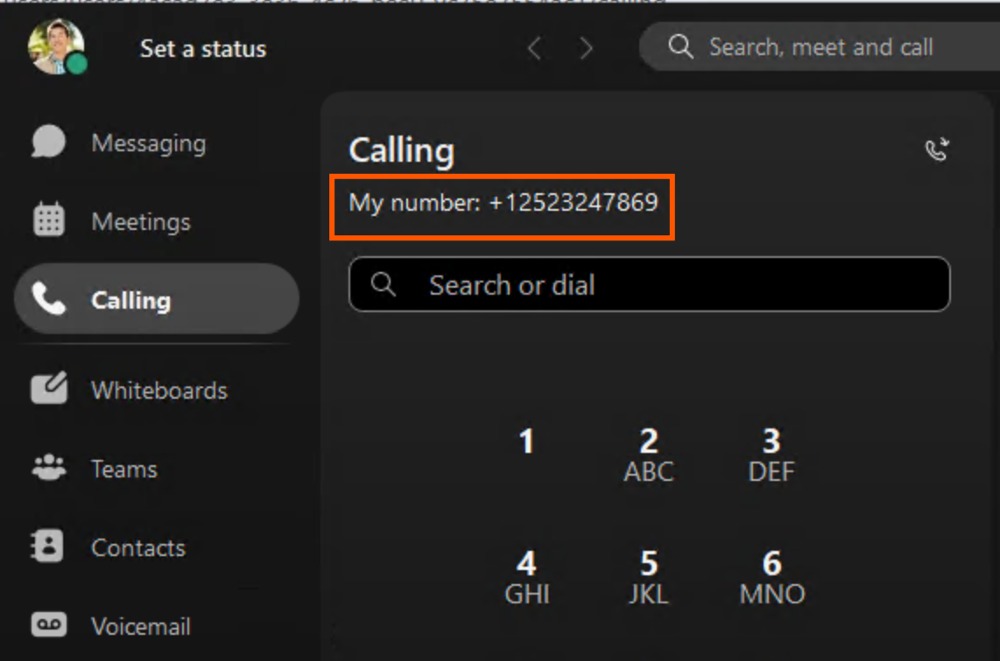
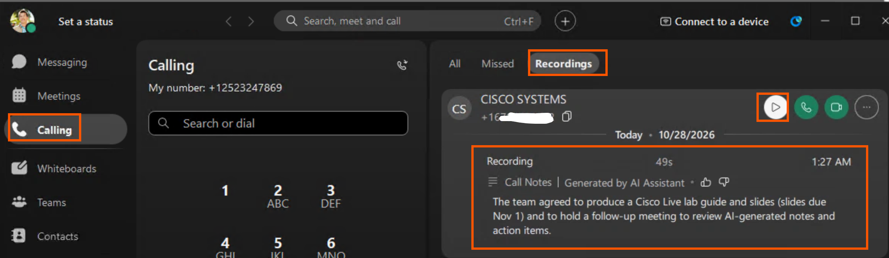
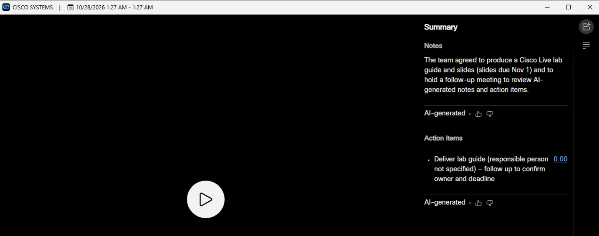
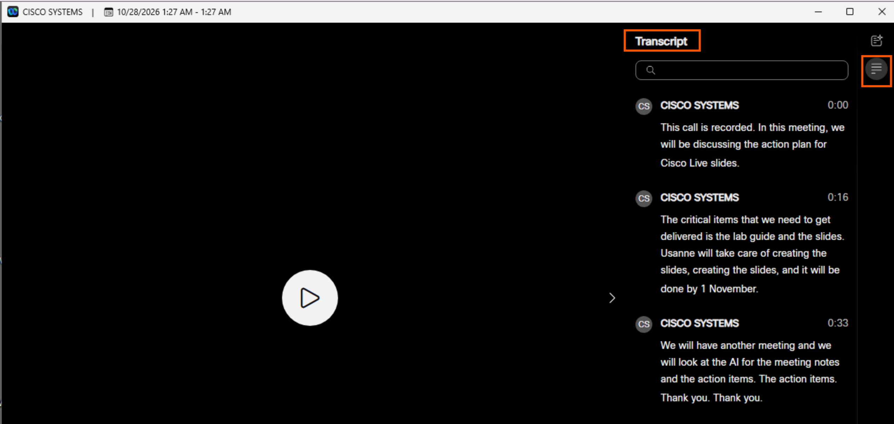

> **Lab data notice:** Values in screenshots are examples from the source guide. Use the credentials, addresses, phone numbers, and session details assigned to your own pod.

# Module 3: AI-generate a transcript for calls recorded by Webex call provider

You can configure automatic transcription for recorded calls. Users can see the transcript in the player when they play the recording from Webex App or User Hub. Transcripts are currently available only for calls recorded by the Webex call recording provider and when the call is in English.

As part of this module, we will test inbound PSTN calls as well.

First, we will enable call recording at the user level, for the user Charles Holland in our organization.

1. Go to Management > Users > select Charles Holland. Then go to Calling > User Call Experience > Call recording.
<figure class="lab-figure">
  
  <figcaption>Source guide screenshot 47. Use the values assigned to your own lab pod.</figcaption>
</figure>

2. Turn on call recording with the settings shown below.
3. Turn on Generate Transcript. Click Save.
<figure class="lab-figure">
  
  <figcaption>Source guide screenshot 48. Use the values assigned to your own lab pod.</figcaption>
</figure>

## Module 3a: Test Inbound PSTN Calls to Webex Calling via LGW

1. Continuing on Workstation 1, Sign out from the Webex App and Sign back in with the same credentials as before. This will allow you to see the Recording tab within the Webex App.
<figure class="lab-figure">
  
  <figcaption>Source guide screenshot 49. Use the values assigned to your own lab pod.</figcaption>
</figure>

2. If you are NOT able to dial US-based phone numbers from your mobile phone, place an outbound call to the previously dialed number and you will hear a recording stating that this call is being recorded.
<figure class="lab-figure">
  
  <figcaption>Source guide screenshot 50. Use the values assigned to your own lab pod.</figcaption>
</figure>

<figure class="lab-figure">
  
  <figcaption>Source guide screenshot 51. Use the values assigned to your own lab pod.</figcaption>
</figure>

<figure class="lab-figure">
  
  <figcaption>Source guide screenshot 52. Use the values assigned to your own lab pod.</figcaption>
</figure>

3. If you are able to dial US-based numbers from your mobile phone, please proceed on the next page with an inbound call to the Webex App.
4. Dial your user’s (Charles Holland’s) Cisco Calling Plan number that was assigned in an earlier module.
<figure class="lab-figure">
  
  <figcaption>Source guide screenshot 53. Use the values assigned to your own lab pod.</figcaption>
</figure>

5. Answer the call from the Webex App and keep it up for 20 seconds, talking all this while. You will hear the call recording announcement as the call is being recorded.
6. Hang up the call and proceed to the next section.
## Module 3b: Access AI-generated summaries for call recordings from the Webex App.

Want to catch up on the discussion that happened in a call? When enabled by your organization’s administrator, AI can generate a summary when you play back a call recording. The summary lists the action items and provides the full transcript from the call. So, you can quickly catch up on the discussion and get a better understanding of the conversation at a glance.

1. From the Webex App, click Calling, and then go to Recordings.
<figure class="lab-figure">
  
  <figcaption>Source guide screenshot 54. Use the values assigned to your own lab pod.</figcaption>
</figure>

<figure class="lab-figure">
  
  <figcaption>Source guide screenshot 55. Use the values assigned to your own lab pod.</figcaption>
</figure>

2. Hover over a recording and click to open the recording player, and see the full AI-generated summary, with notes, and action items.
<figure class="lab-figure">
  
  <figcaption>Source guide screenshot 56. Use the values assigned to your own lab pod.</figcaption>
</figure>

3. Action items contain a timestamp, to help you easily navigate to the part of the recording in which you're interested.
In the recording player, select from:

—AI summary, notes, and action items.

<figure class="lab-figure">
  
  <figcaption>Source guide screenshot 57. Use the values assigned to your own lab pod.</figcaption>
</figure>

<figure class="lab-figure">
  
  <figcaption>Source guide screenshot 58. Use the values assigned to your own lab pod.</figcaption>
</figure>

4. —view the call transcript.
<figure class="lab-figure">
  
  <figcaption>Source guide screenshot 59. Use the values assigned to your own lab pod.</figcaption>
</figure>

This completes the lab activity.
